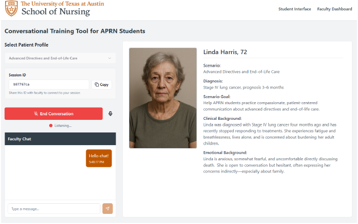
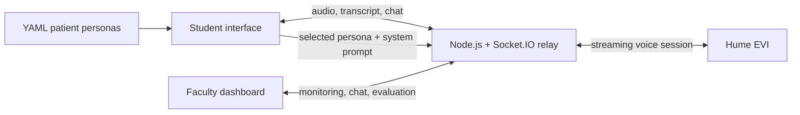

# PraxiCom

A faculty-directed voice simulation for advanced practice nursing education.

I individually built PraxiCom (formerly CareSpeak) in spring 2025 for an AI in Healthcare
course and UT Austin School of Nursing's [NURSING-AI Challenge](https://nursing.utexas.edu/research/centers-initiatives/ai-challenge),
with guidance from nursing faculty member Dr. Cara Young. The prototype connects a live
AI-patient conversation with a student workspace, faculty monitoring, structured evaluation,
and session export.



*Student interface from the spring 2025 prototype.*

## Why I built it

PraxiCom was my response to Challenge 17: a way for nursing students to practice sensitive
conversations, including discussions of end-of-life wishes, with a synthetic patient.
Faculty can follow the transcript, send feedback, and review communication within the same session.

I implemented the student and faculty workflows, streaming voice integration, scenario
definitions, and session-record handling with nursing-faculty guidance.

## What I built

- Real-time speech interaction through Hume AI's Empathic Voice Interface (EVI)
- YAML-authored patient personas with editable clinical context, emotional state, learning goals, and conversation guidance
- A student workspace for persona selection, session control, and faculty chat
- A faculty dashboard for joining by session ID, monitoring the transcript, quoting messages, and sending feedback
- Faculty-defined evaluation criteria with rubric ratings and qualitative notes
- Local JSON export of the transcript, chat history, scores, and notes
- Session-end persistence in the faculty view so an evaluation can be completed after the student disconnects

The Advanced Directives scenario demonstrates the live voice workflow. Additional patient scenarios are supplied as YAML definitions.

## Architecture



The browser streams microphone chunks to the relay server. The server owns session membership and forwards student audio to Hume EVI. Transcriptions, AI responses, synthesized audio, and faculty chat are broadcast through a session-specific Socket.IO room. Session data remains in memory for the life of the server; faculty exports are generated locally in the browser.

See [docs/system-design.md](docs/system-design.md) for the event contract and module map.

## Project structure

```text
src/
  components/        Student/faculty interface components
  contexts/          Socket provider and context contract
  data/              Evaluation rubric
  hooks/             Socket and audio playback hooks
  pages/             Student and faculty routes
  services/          Persona loading and validation
  types/             Client domain types
server/src/
  services/          In-memory sessions and Hume EVI adapter
  socket/            Socket.IO event lifecycle
  types/             Server domain types
public/personas/     Synthetic patient definitions and portraits
docs/                Original challenge submission and design notes
```

## Run locally

Running this version requires a Hume API account and an EVI configuration compatible with its SDK integration.

### Prerequisites

- Node.js 18 or newer
- npm
- Hume API and secret keys

### Install and configure

```bash
git clone https://github.com/rjleggieri/ut-nursing-ai.git
cd ut-nursing-ai
npm install
npm --prefix server install
```

Copy the example environment files and add your own credentials:

```bash
cp .env.example .env
cp server/.env.example server/.env
```

`server/.env`:

```dotenv
PORT=3001
CLIENT_URL=http://localhost:5173
HUME_API_KEY=your_hume_api_key
HUME_SECRET_KEY=your_hume_secret_key
```

Start the backend and frontend in separate terminals:

```bash
npm --prefix server run dev
npm run dev
```

Open `http://localhost:5173`. Start a student session, copy its eight-character ID, and use it from the Faculty Dashboard in a second browser tab.

## Quality checks

```bash
npm run lint
npm run build
npm --prefix server test
```

## Original submission

- [Project report](docs/Challenge.17_Leggieri.Report.pdf)
- [Challenge presentation](docs/Challenge.17_Leggieri.Slides.pdf)
- [Showcase handout](docs/Challenge.17_Leggieri.Handout.pdf)

The original submission uses the project's earlier working title, CareSpeak. It describes the April 2025 prototype, its adaptation of GuideLLM concepts (goal navigation, context management, and empathetic engagement), and the ethical considerations around synthetic patients, student records, third-party AI services, HIPAA, and FERPA.

## Scope and limitations

PraxiCom was an academic proof of concept, not a clinical product or validated educational intervention. It has no authentication, durable database, learning-management-system integration, or formal privacy/compliance controls. All included patients are synthetic. Do not use it with protected health information, real patient data, or student education records.

This repository preserves the spring 2025 implementation and is not under active development. The architecture and project materials document the streaming voice integration, student/faculty session workflow, and structured communication review.
