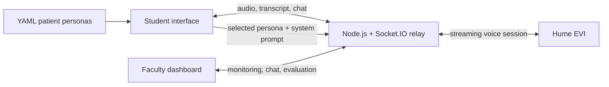

# CareSpeak

> **Archived portfolio project** - built in spring 2025 for an AI in Healthcare course and the University of Texas at Austin School of Nursing's [NURSING-AI Challenge](https://nursing.utexas.edu/research/centers-initiatives/ai-challenge). This repository is preserved as a proof of concept and is not under active development.

CareSpeak is a voice-based simulation tool for Advanced Practice Registered Nurse (APRN) students to practice emotionally sensitive patient conversations. It pairs clinician-authored patient personas with a generative voice model, while giving faculty a live transcript, a private coaching channel, a structured evaluation rubric, and a downloadable session record.

## Why I built it

Sensitive conversations - discussing end-of-life wishes, counseling an adolescent, or communicating a chronic diagnosis - require practice as much as clinical knowledge. Standardized-patient encounters are effective, but they are expensive, difficult to schedule, and hard to repeat.

The NURSING-AI Challenge invited graduate students and faculty advisors to build AI responses to real problems submitted by nursing faculty. CareSpeak was my response to Challenge 17, developed with faculty guidance from Dr. Cara Young. The prototype explored whether a faculty-controlled, synthetic AI patient could provide a scalable practice environment without using real patient data.

## What the prototype demonstrates

- Real-time speech interaction through Hume AI's Empathic Voice Interface (EVI)
- Four faculty-oriented, YAML-authored patient scenarios with clinical context, emotional state, learning goals, and conversation guidance
- A student workspace for persona selection, session control, and faculty chat
- A faculty dashboard for joining by session ID, monitoring the transcript, quoting messages, and sending feedback
- A 10-criterion evaluation rubric with qualitative notes
- Local JSON export of the transcript, chat history, scores, and notes
- Session-end persistence in the faculty view so an evaluation can be completed after the student disconnects

Only the Advanced Directives scenario is configured for live voice in the archived prototype. The remaining personas document how the scenario library was intended to expand.

## Architecture



The browser streams microphone chunks to the relay server. The server owns session membership and forwards student audio to Hume EVI. Transcriptions, AI responses, synthesized audio, and faculty chat are broadcast through a session-specific Socket.IO room. Session data remains in memory for the life of the server; faculty exports are generated locally in the browser.

See [docs/system-design.md](docs/system-design.md) for the event contract and module map.

## Project structure

```text
src/
  components/        Student/faculty interface components
  contexts/          Socket provider and context contract
  data/              Evaluation rubric
  hooks/             Socket and audio playback hooks
  pages/             Student and faculty routes
  services/          Persona loading and validation
  types/             Client domain types
server/src/
  services/          In-memory sessions and Hume EVI adapter
  socket/            Socket.IO event lifecycle
  types/             Server domain types
public/personas/     Synthetic patient definitions and portraits
docs/                Original challenge submission and design notes
```

## Run locally

This is a legacy demonstration that depends on a Hume API account and an EVI configuration compatible with the archived SDK integration.

### Prerequisites

- Node.js 18 or newer
- npm
- Hume API and secret keys

### Install and configure

```bash
git clone https://github.com/rjleggieri/ut-nursing-ai.git
cd ut-nursing-ai
npm install
npm --prefix server install
```

Copy the example environment files and add your own credentials:

```bash
cp .env.example .env
cp server/.env.example server/.env
```

`server/.env`:

```dotenv
PORT=3001
CLIENT_URL=http://localhost:5173
HUME_API_KEY=your_hume_api_key
HUME_SECRET_KEY=your_hume_secret_key
```

Start the backend and frontend in separate terminals:

```bash
npm --prefix server run dev
npm run dev
```

Open `http://localhost:5173`. Start a student session, copy its eight-character ID, and use it from the Faculty Dashboard in a second browser tab.

## Quality checks

```bash
npm run lint
npm run build
npm --prefix server test
```

## Original submission

- [Project report](docs/Challenge.17_Leggieri.Report.pdf)
- [Challenge presentation](docs/Challenge.17_Leggieri.Slides.pdf)
- [Showcase handout](docs/Challenge.17_Leggieri.Handout.pdf)

The submission describes the April 2025 prototype, its adaptation of GuideLLM concepts (goal navigation, context management, and empathetic engagement), and the ethical considerations around synthetic patients, student records, third-party AI services, HIPAA, and FERPA.

## Scope and limitations

CareSpeak was an academic proof of concept, not a clinical product or validated educational intervention. It has no authentication, durable database, learning-management-system integration, or formal privacy/compliance controls. All included patients are synthetic. Do not use it with protected health information, real patient data, or student education records.

Modern multimodal AI platforms now provide much of this prototype's voice and orchestration capability directly. That makes the original product direction obsolete, but the project remains a useful record of the design problem, the 2025 implementation choices, and an early attempt to make generative patient simulation observable and faculty-directed.
